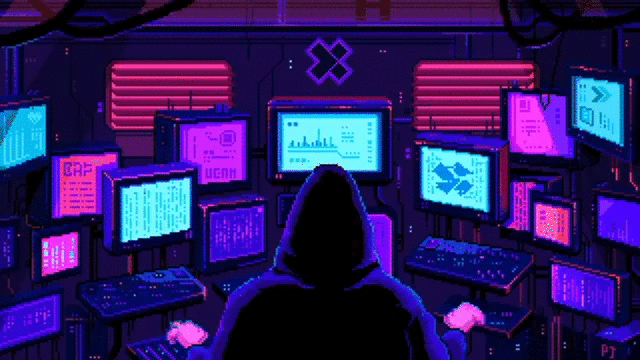

<table>
  <tr>
    <td align="center" width="150">
      
    </td>
    <td align="center">
      <em><strong>•|| Driven by discipline. Powered by consistency. Inspired by creativity – in code and in combat 🥋❤️⭐</strong></em>
    </td>
    <td align="center" width="150">
      
    </td>
  </tr>
</table>

Hi , I'm Nethmini Jayamani ! ❤

<table width="100%">
  <tr>
    <td align="left" width="60%">
      I’m a passionate undergraduate from NSBM Green University with experience in mobile app development and competitive Karate. I love creating modern, user-friendly apps and representing Sri Lanka in national-level sports.
    </td>
    <td align="right" width="40%">
      
    </td>
  </tr>
</table>

🛠 Tech Stack

Languages: Dart, Java, HTML, CSS, JavaScript, PHP

Frameworks: Flutter, React.js, Express.js, Node.js (MERN Stack)

Database & Backend: Firebase (Authentication, Firestore, Realtime DB), MySQL, MongoDB, MongoDB Atlas

Tools: Git, GitHub, Figma, Canva, Adobe XD, Android Studio, XAMPP

Other Skills: UI/UX Design, QR Code Scanning Integration, Face Scan Integration, Responsive Web Design

<h3 align="center">🏆 Achievements</h3>

<table>
  <tr>
    <td>

- 🔹 **Best Player – NSBM Sports Fiesta 2025** 🥋🎖  
- 🔹 **National Level Karate Player** 🥋🎖  
- 🔹 **NSBM Karate Club – Girls' Captain** 🥋  
- 🔹 **Volunteer & Designer – NSBM Clubs**

    </td>
    <td align="right">
      
    </td>
  </tr>
</table>

<h3>📱 Projects</h3>

💻 Completed Projects

1. 🚌 GoWay – Public Transport Service

A Flutter-based mobile application designed to modernize public transportation in Sri Lanka. The platform includes QR code-based fare payments, real-time GPS tracking, seat reservations, and a complaint and feedback system.

Technologies: Flutter, Dart, QR Code Integration, GPS Tracking

📂 GitHub Repository

🖼️ Project Preview

2. 🎓 EduTrack – Student Academic Management System

A student academic management application designed to help students monitor their academic progress. Features include GPA calculation, score planning, module credit management, schedule organization, and deadline notifications.

Technologies: Flutter, Dart, Firebase, UI/UX Design

📂 GitHub Repository

🖼️ Project Preview

3. 🔧 KAduna – Smart Garage Management System

A garage management solution designed to simplify daily garage operations through appointment booking, inventory tracking, customer management, service management, and billing.

Technologies: C#, Web Development, Database Management

🖼️ Project Preview

4. 🛋️ Furniture Design App

A modern furniture visualization platform that allows users to design and preview interior layouts. The application supports interactive furniture placement, secure authentication, and responsive user interfaces.

Technologies: React, Next.js, TypeScript, Tailwind CSS, Node.js, Three.js

📂 GitHub Repository

🌐 Live Demo

🖼️ Project Preview

5. 🧠 MoodMart – Mental Wellness & E-Commerce Platform

A full-stack mental wellness and e-commerce platform combining personalized wellness features with online shopping. The system includes secure authentication, mood tracking, face-based emotion analysis, guided audio therapy, product management, and Stripe payment integration.

Technologies: React.js, Node.js, Express.js, MongoDB, Tailwind CSS, Stripe API

📂 GitHub Repository

🌐 Live Demo

🖼️ Project Preview

6. 🎬 Silent Cinema – Movie Booking System

A responsive cinema website that enables users to explore movies, manage booking schedules, select seats, and book movie tickets online.

Technologies: HTML, CSS, JavaScript, PHP, MySQL

📂 GitHub Repository

🖼️ Project Preview

7. 🌿 Aura Serene – E-Commerce & Wellness Concept

A wellness-oriented digital concept focused on eco-friendly skincare products and candles. The e-commerce platform features product browsing, an intuitive interface, user authentication, checkout functionality, and customer feedback options.

Technologies: HTML, CSS, Bootstrap, JavaScript, UI/UX Design

🖼️ Project Preview

8. 🎟️ EventHub – Event Registration System

A modern full-stack web application for event registration, featuring a responsive user interface, real-time form validation, MongoDB Atlas integration, and automated email notifications.

Technologies: Next.js, React, Tailwind CSS, MongoDB Atlas, Nodemailer

📂 GitHub Repository

🌐 Live Demo

🖼️ Project Preview

9. 🛒 ECO Mart – Supermarket POS & Inventory Management System

A PHP and MySQL-based point-of-sale and inventory management system designed for supermarkets and retail stores. Features include barcode-based checkout, product and stock management, supplier management, cashier shift management, returns processing, and sales reporting.

Technologies: PHP, MySQL, JavaScript, HTML, CSS, XAMPP

📂 GitHub Repository

🖼️ Project Preview

<h3 align="center">📚 Research</h3>

<table align="center" style="background-color:#f3e8ff; border:2px solid #a855f7; border-radius:10px; padding:15px; width:90%;">
  <tr>
    <td align="left" width="50%" style="color:#4b0082; padding-right: 20px;">
      
<strong style="color:#6b21a8;">🖊️ Co-Author:</strong> <em>"Enhancing Security with Biometric and Heart Rate Data Integration"</em>

      
<strong style="color:#6b21a8;">📍 Published at:</strong> ICACT – NSBM Green University 2024 Conference

      
<strong style="color:#6b21a8;">🔐 Focus:</strong> Conducted research on biometric authentication and cybersecurity under expert guidance.

    </td>
    <td align="center" width="50%">
      
    </td>
  </tr>
</table>

✨ Highlights

Over 10 years of Karate experience – 3rd Dan Black Belt

Designed UI/UX for multiple NSBM club initiatives

Strong leadership, teamwork, and public speaking skills

<h3 align="center">📫 Connect with me:</h3>

  
  
  
  

## 📫 Let's Connect!

